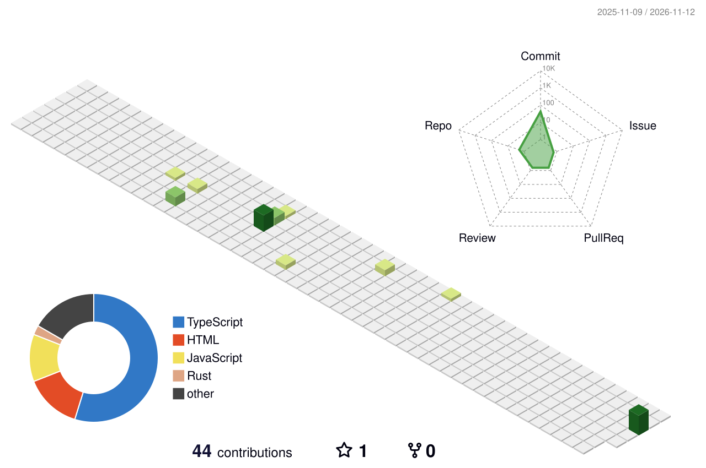

<div align="center">


<br/>

<a href="https://www.linkedin.com/in/maxime-behr67000"></a>


</div>

<br/>

## About me

```ts
const maxime = {
  role: "Software Engineer",
  school: "Epitech Strasbourg — 5th year",
  focus: ["Full-stack web", "Embedded systems", "Automation & AI tooling"],
  currentlyBuilding: [
    "A SaaS for independent nurses",
    "A personal AI assistant for dev & business workflows",
  ],
  motto: "If I do it twice, I automate it.",
};
```

## Tech stack

<p align="center">
  
  <br/>
  
  <br/>
  
</p>

## Featured projects

<p align="center">
  <a href="https://github.com/mxbhr/phonehome"><b>⭐ phonehome</b></a> — See which apps on your machine phone home, and to whom. A Rust agent reads the kernel socket table over netlink and draws every app's connections on a live globe.
  <br/><br/>
     
</p>

<p align="center">
  <a href="https://github.com/mxbhr/ngap-engine"><b>⭐ ngap-engine</b></a> — Explainable billing engine for French independent nurses: cumulation rules, surcharges and travel allowances, with the rule behind every euro.
  <br/><br/>
     
</p>

<table>
  <tr>
    <td width="33%" valign="top">
      <h3><a href="https://github.com/Altevo-organization/codaryn-demo-erp">ERP Dashboard</a></h3>
      <p>Business management dashboard with real-time data visualization.</p>
        
    </td>
    <td width="33%" valign="top">
      <h3><a href="https://github.com/Altevo-organization/codaryn-demo-fleet">Fleet Tracker</a></h3>
      <p>Vehicle fleet tracking on an interactive live map.</p>
        
    </td>
    <td width="33%" valign="top">
      <h3><a href="https://github.com/Altevo-organization/codaryn-demo-booking">Booking System</a></h3>
      <p>Online reservation platform with a smooth, animated UI.</p>
        
    </td>
  </tr>
</table>

## Contributions

<p align="center">
  <picture>
    <source media="(prefers-color-scheme: dark)" srcset="./profile-3d-contrib/profile-night-rainbow.svg"/>
    
  </picture>
</p>

<p align="center">
  <picture>
    <source media="(prefers-color-scheme: dark)" srcset="https://raw.githubusercontent.com/mxbhr/mxbhr/output/github-contribution-grid-snake-dark.svg"/>
    
  </picture>
</p>


